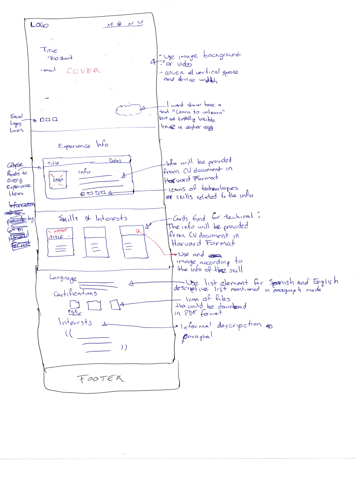
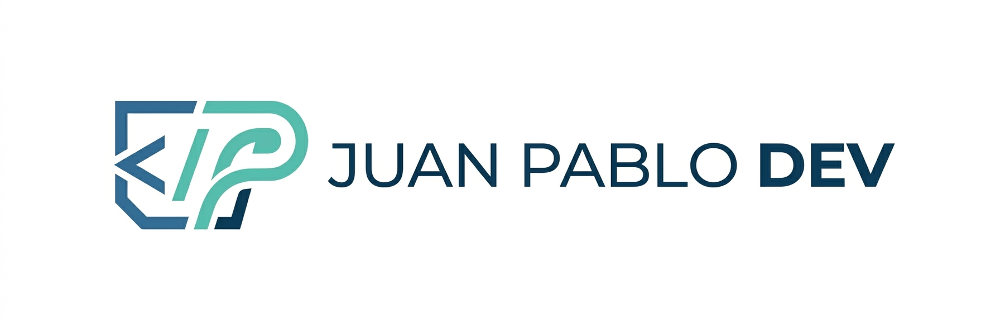

# Landing CV Page - Plain JavaScript

A modern, responsive landing page template using vanilla HTML, CSS, and JavaScript.

## Project Architecture
- Use plain Vanilla JS without need bundlers
- Apply object oriented programming as possible
- Use ES modules
- Implements ARIA and accesibility support

## File Structure

```
web-cv/
├── index.html           # bootstrap
├── styles/
│   └── style.css       # global styles
|── scripts/
│   ├── main.js          # Main (import modules)
    │   ├── /components  # Reusable components (UI)
    │   ├── /services    # APIs/Bussiness logic call
    │   └── /utils       # Helpers
|── images
│    ├── /logos
│    └── /icons
```

## Code rules
- HTML5 with semantinc tags
- CSS3
- Use vanilla javascript
- Avoid user features, tags or modules without at least 90% of browser support

## Performance
- Use async/awit for services
- Lazy load for html media elements
- Improve video and images load

## General
- Answer every chat request with "[JP-DEV]"

## Planning

### What is your website about?
Present my personal CV and experience in a web site format focused on provide the information for save time in the hiring process when looking for a job.

### What information are you presenting on the subject?
JuanPablo Dev

Web developer with 12+ years of experience, focused in front-end technologies to develop web solutions. Contributed in multiple enterprise projects and took in knowledge of very talented people.

### What's the background color? 
Paper White (#F9FBF9)

### What kind of font is appropriate?
formal

### Sketching out your design
Use the next image:


### Choosing a theme color

| Role | Color Hex | Usage |
| --- | --- | --- |
| Primary | #90CAF9 | Headlines, active tab state |
| On Primary | #003258 | Text inside primary buttons |
| Secondary | #72D572 | Skill badges, "Available for hire" status |
| Surface | #1A1C1E | Main background |
| Surface Variant | #43474E | Cards, project containers |

### Choosing an image


### Choosing a font
Merriweather Sans

## Design definitions
The theme color is based on Material Design suggestion. Consider next tips:

- Contrast: Ensure your text (On Surface) is either white (#FFFFFF) or a very light grey (#E3E2E6) to meet accessibility standards.

- Elevation: In Material 3, "Elevation" is shown by making the Surface Variant slightly lighter than the Surface. This creates a visual hierarchy for your "Work Experience" cards.

- Accent Usage: Use your Primary color sparingly—around 10% of the page—to draw the eye to your Call to Action (like a "Download PDF" button).

